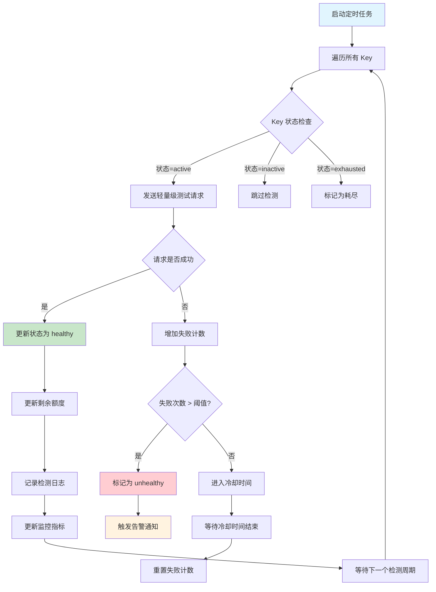
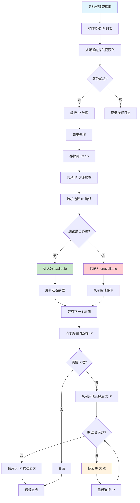
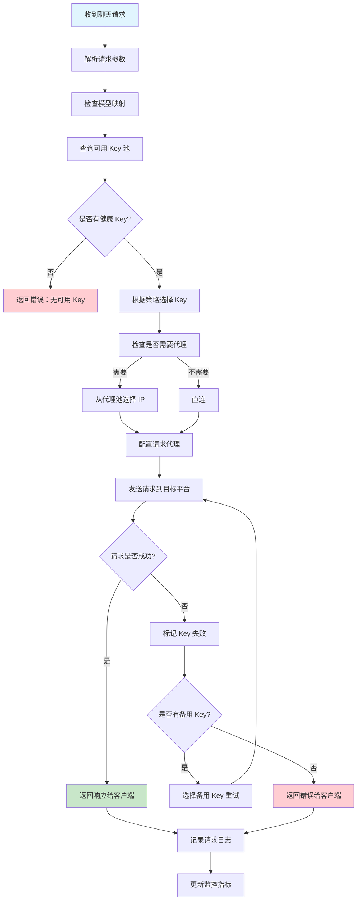
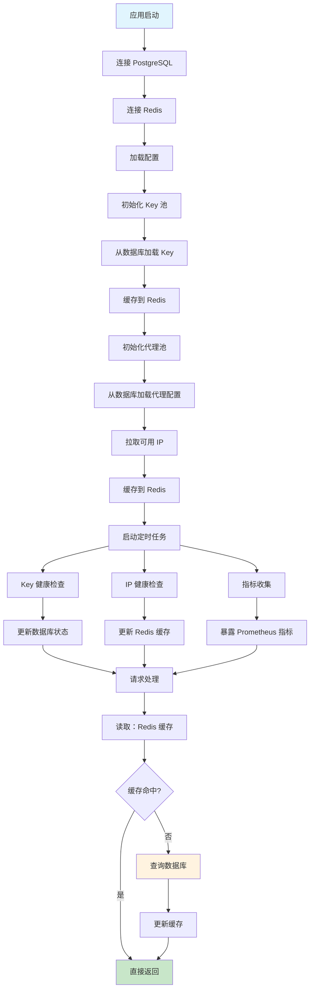
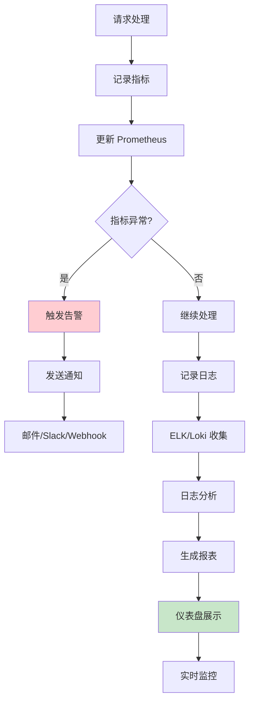

# 动态 Key 检测和代理 IP 池实现流程图

## 1. Key 动态检测流程

### Key 检测详细步骤：

1. **定时触发**：每分钟执行一次检测任务
2. **Key 筛选**：只检测 active 状态的 Key
3. **测试请求**：
   - OpenAI/Anthropic：调用 `/models` 接口
   - 其他平台：发送最小 token 的聊天请求
   - 设置超时时间（默认 5 秒）
4. **状态更新**：
   - 成功：更新状态、剩余额度、延迟
   - 失败：增加失败计数，达到阈值则标记 unhealthy
5. **冷却机制**：
   - unhealthy 的 Key 进入冷却时间（指数退避）
   - 冷却结束后自动重置检测

## 2. 代理 IP 池管理流程

### 代理 IP 管理详细步骤：

1. **IP 拉取**：
   - 定时从配置的提供商 API 拉取
   - 支持青果网络、芝麻代理等主流服务商
   - 解析 IP、端口、协议、地理位置等信息

2. **IP 健康检查**：
   - 随机选择可用 IP 进行延迟测试
   - 测试目标：知名网站（如 google.com）
   - 记录延迟数据，计算平均延迟

3. **IP 选择策略**：
   - 优先选择延迟最低的 IP
   - 支持按国家/地区筛选
   - 自动剔除失效 IP

4. **请求路由**：
   - 检查渠道是否需要代理
   - 从可用 IP 池选择最优 IP
   - 如果 IP 失效，自动重试其他 IP

## 3. 智能路由流程

### 智能路由详细步骤：

1. **请求解析**：
   - 提取模型名称、消息列表、参数
   - 验证请求格式和参数合法性

2. **Key 选择**：
   - 根据模型查找可用 Key
   - 考虑因素：平台、剩余额度、延迟、权重
   - 支持轮询、加权、最少使用等策略

3. **代理配置**：
   - 检查渠道是否需要代理
   - 选择最优代理 IP
   - 配置请求的代理参数

4. **请求发送**：
   - 使用选定的 Key 和代理发送请求
   - 设置超时和重试机制
   - 处理流式响应

5. **错误处理**：
   - 标记失败 Key
   - 自动切换到备用 Key
   - 记录错误日志

6. **响应返回**：
   - 统一转换为 OpenAI 格式
   - 支持流式和非流式响应
   - 记录请求日志和指标

## 4. 数据库交互流程

## 5. 监控与告警流程

### 监控指标列表：

1. **请求指标**：
   - 总请求数
   - 成功率
   - 平均延迟
   - 各模型使用量

2. **Key 指标**：
   - 活跃 Key 数
   - 健康 Key 数
   - 各平台 Key 分布
   - Key 使用频率

3. **代理指标**：
   - 可用 IP 数
   - 平均延迟
   - IP 失效率
   - 各提供商 IP 分布

4. **系统指标**：
   - CPU/内存使用率
   - 网络流量
   - 数据库连接数
   - Redis 缓存命中率
